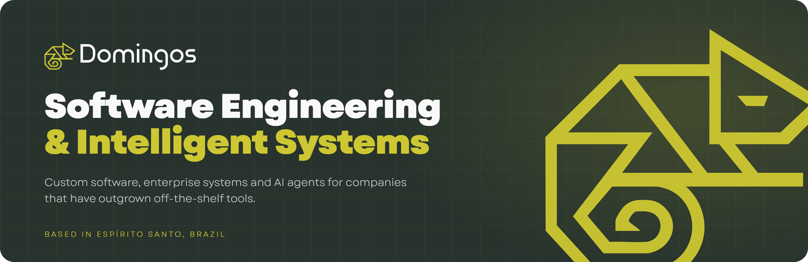
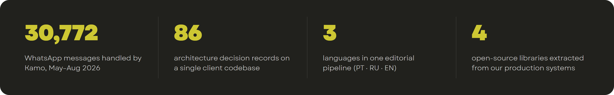
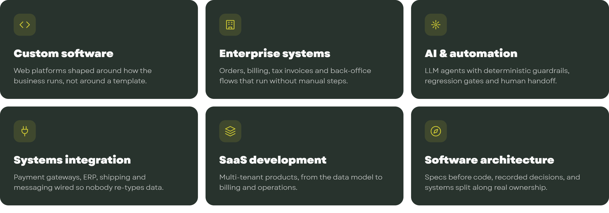
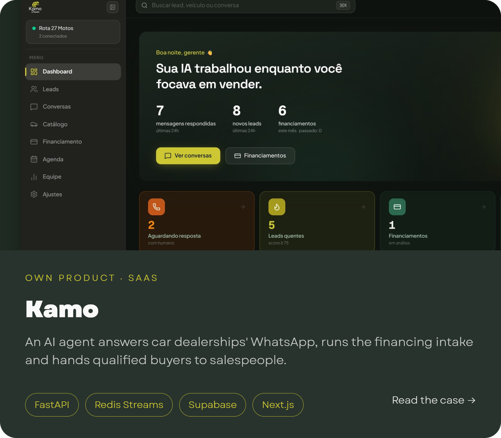
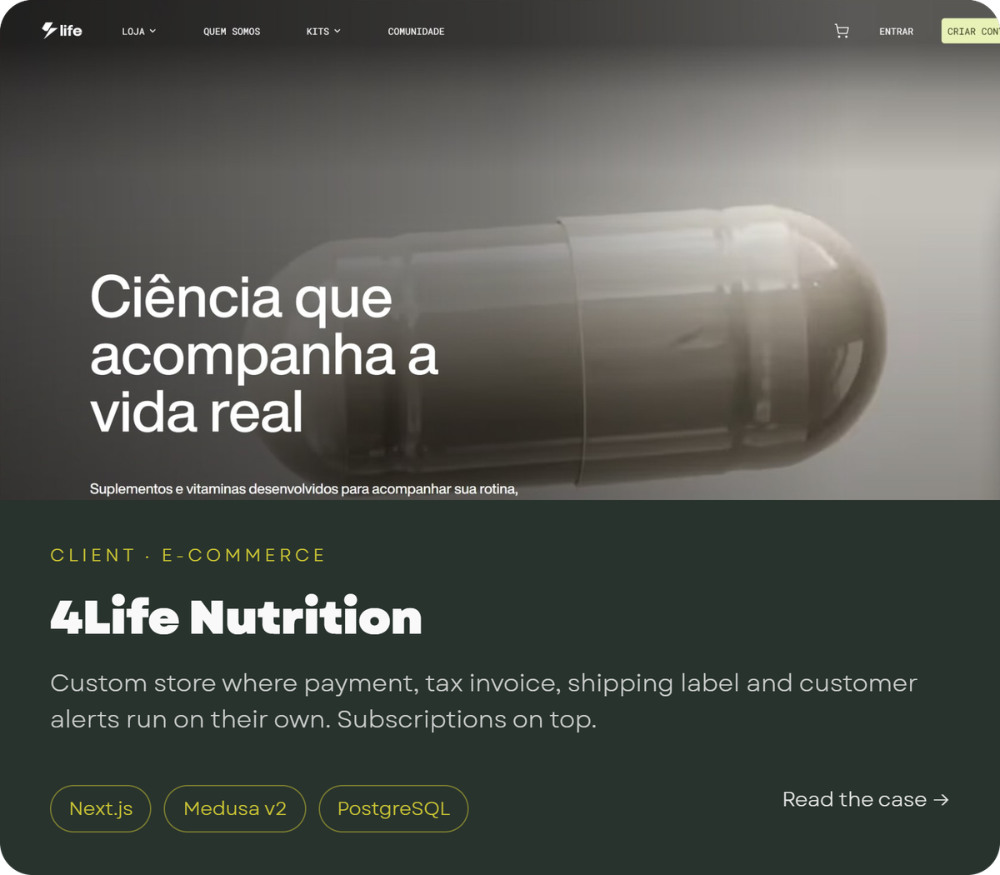
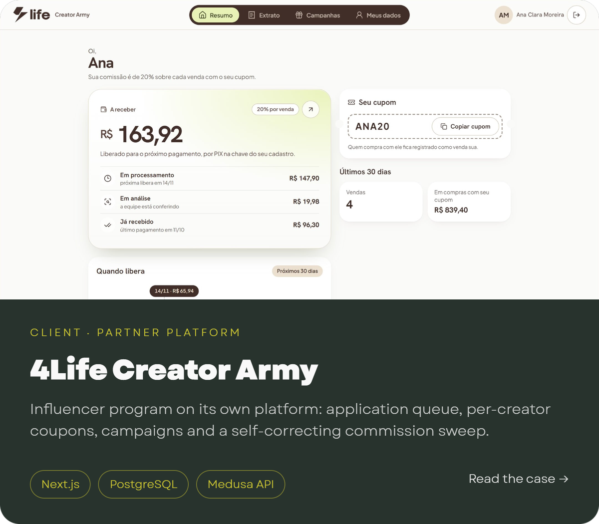

  

We design, build and run custom systems for companies that have outgrown off-the-shelf
tools: stores that handle the whole order on their own, partner programs where a wrong
number means wrong money in someone's pocket, multilingual institutional portals, and AI
agents that talk to customers in production.

  

 

### What we do

  

 

### Selected work

<table>
  <tr>
    <td width="50%" valign="top">
      
    </td>
    <td width="50%" valign="top">
      
    </td>
  </tr>
  <tr>
    <td width="50%" valign="top">
      
    </td>
    <td width="50%" valign="top">
      
    </td>
  </tr>
</table>

Client code stays with the client. Each case study shows screens, architecture and
the decisions behind the system, uses demo data wherever a screen would show real people,
and says plainly what is in production, what is ready for release and what is still being
built.

 

### How we work

- **Specs before code.** Every feature starts as a written spec, and every decision that shapes the system is recorded with its reasons, so the next engineer, or the client, can see why.
- **The machine decides money, a person decides doubt.** Payments only count when the gateway confirms them; anything suspicious waits for a human instead of being silently blocked or approved.
- **Built to recover.** Jobs are idempotent and re-runnable, integrations fail loudly, and a stuck order can be resumed instead of rebuilt by hand.
- **Reviewed before it ships.** Releases go through CI, adversarial review and, where the stakes are high, penetration testing in production.
- **AI with guardrails.** Models handle language; deterministic code handles rules, prices and money, and replay tests catch it when that line is crossed.

 

### Open source, extracted from production

| | |
|---|---|
| [**burstq**](https://github.com/Dowgg18/debounced-webhook-pipeline) | Collapses a burst of chat webhooks into one ordered unit of work per conversation, and survives a crash in the middle of it. |
| [**replaygate**](https://github.com/Dowgg18/agent-replay-gate) | A pre-deploy regression gate for conversational agents: replay conversations with every I/O boundary sealed. |
| [**proven**](https://github.com/Dowgg18/unhealthy-until-proven) | A health check has three outcomes, not two: measured, stale and unknown. |
| [**reachable**](https://github.com/Dowgg18/covered-but-unreachable) | Finds code your tests execute and your users can never reach. |

 

### Technology

**Backend** Python · FastAPI · Node.js · TypeScript · PostgreSQL · Redis Streams · Supabase · Medusa  
**Frontend** Next.js · React · Tailwind CSS  
**AI** Claude and other LLM APIs · agent evaluation and replay testing  
**Operations** Docker · Traefik · GitHub Actions · Playwright

 

### Work with us

We take on a small number of projects at a time, from a first architecture review to
building and running the whole system.

**Douglas Domingos**, founder · [LinkedIn](https://www.linkedin.com/in/douglas-c-domingos/) · [douglascunhadomingos@gmail.com](mailto:douglascunhadomingos@gmail.com)
